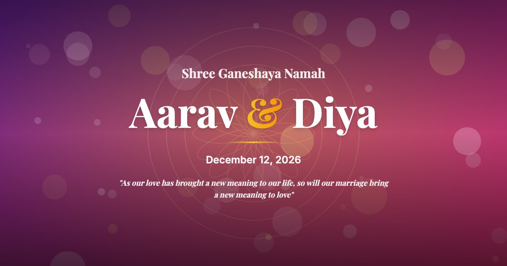

# Wedding Melody Page

A free, open-source wedding invitation website you can make your own in an afternoon. It works on phones, plays background music, and looks good when shared on WhatsApp.



**What guests see**

- A welcome screen with your names, date, a blessing line, and a quote (with an optional background video)
- A timeline of your wedding events with photos and times
- Your families, with an optional tribute to elders
- The venue with a live Google Map and an "Open in Google Maps" button
- Soft background music with a mute button

**Never written code before?** Follow the step-by-step guide: **[GUIDE.md](GUIDE.md)**. You'll get your own copy, ask Claude to fill in your details in plain English, and put the site online for free with Vercel.

## For developers

```sh
npm install
npm run dev      # http://localhost:8080
npm run build    # production build in dist/
```

All personal content lives in [`src/wedding.config.ts`](src/wedding.config.ts). Media goes in `public/images`, `public/audio`, and `public/videos`. Page title and link preview tags in `index.html` are filled from the config at build time by a small plugin in `vite.config.ts`.

Built with Vite, React, TypeScript, Tailwind CSS, and shadcn/ui.

## Credits

The placeholder artwork and the background music loop were made for this project and are covered by the MIT license. When you add your own photos, videos, or songs, make sure you have the right to use them.

## License

[MIT](LICENSE)
